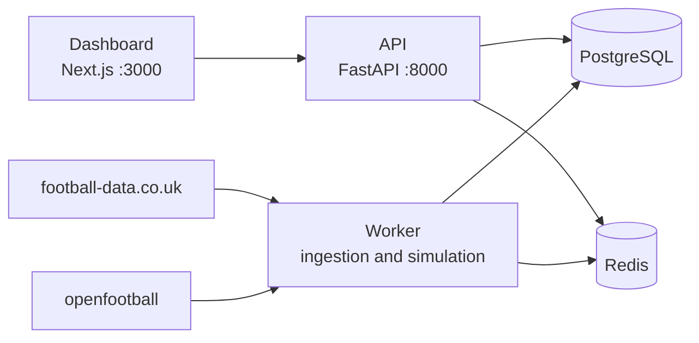

# LaLiga Match Intelligence

A local system that predicts Spanish La Liga matches, simulates the rest of the season, and measures its own accuracy against real results and the betting market. A team focus mode gives a deep view of one club (default: Valencia CF).

## Status

Milestone M0 is done: monorepo skeleton, Docker Compose stack, CI, and pinned tool and image versions.

M1 is next: ingestion, team-name normalization, database schema and migrations.

Scope and acceptance criteria live in the [MVP specification](docs/spec/mvp.md). Technical decisions are recorded in the [architecture decision records](docs/adr/).

## Architecture

The dashboard is a Next.js application, the API is a FastAPI service, and the worker runs ingestion, model fitting and simulation jobs. PostgreSQL stores the data and Redis is the cache and job broker. The sources for results and fixtures are external CSV and JSON files that the worker downloads at runtime.



Only the API and the worker touch the database (ADR-0001). The dashboard reads data only through the API.

## Quickstart

Prerequisites: Docker with Compose, and `make`. The stack itself needs nothing else. Two more tools are needed for the host-side commands and for `make setup`: [uv](https://docs.astral.sh/uv/) and [pnpm](https://pnpm.io/).

1. Create the environment file and install the Python and Node dependencies:

   ```sh
   make setup
   ```

   This copies `.env.example` to `.env` when `.env` is missing, then installs both toolchains. If you only want to run the Docker stack, `cp .env.example .env` is enough and uv and pnpm are not required.

2. Edit `.env` and replace the placeholder `POSTGRES_PASSWORD`. The Compose stack refuses to start without a value. Any character is accepted except a newline: the services build the connection URL in code instead of interpolating it into a string.

3. Build and start the stack:

   ```sh
   make up
   ```

   The command builds the images, applies the schema and the seed with the one-shot `migrate` service, waits until db, redis, api and web are healthy, then starts the worker.

4. Open <http://localhost:3000> for the dashboard and <http://localhost:8000/docs> for the OpenAPI documentation. The dashboard shows `API status: online` when it can reach the API.

The worker is a one-shot job: it runs the ingestion command and exits with status 0. A stopped worker container is the expected end state, not an error. The `migrate` service is the other one-shot job: it applies the migrations and the reference-data seed, and `api` and `worker` wait for it to exit 0.

`make clean` stops the stack and deletes the containers and the database volume of the `lmi` Compose project.

## Commands

| Target | Description |
| --- | --- |
| `make help` | Show this help |
| `make setup` | Create .env if missing and install Python and Node dependencies |
| `make up` | Build and start the local Docker Compose stack, then wait for health |
| `make down` | Stop the stack and keep its volumes |
| `make logs` | Follow the logs of every service |
| `make ps` | Show the state of every service |
| `make lint` | Run Python and web linters, formatters and type checks |
| `make test` | Run the Python unit test suite (no database needed) |
| `make test-integration` | Run the integration tests against a throwaway PostgreSQL container |
| `make build` | Build the web application and every Docker image |
| `make clean` | Stop the stack and delete its volumes (project lmi only) |

## Repository layout

```
apps/web/            Next.js dashboard, talks only to the API
apps/api/            FastAPI service, the only entry point to the data
apps/worker/         Python ingestion, model fitting and simulation jobs
packages/core/       Shared Python domain package
docs/adr/            Architecture decision records
docs/spec/           Specifications
docker-compose.yml   Local stack: db, redis, migrate, api, worker, web
Makefile             Developer entry points
.github/workflows/   GitHub Actions CI
```

## CI

GitHub Actions runs lint, type checks, tests and the Compose stack on every pull request and every push to `main`.

## Data sources

- Match results, statistics and odds: [football-data.co.uk](https://www.football-data.co.uk/)
- Fixtures: [openfootball/football.json](https://github.com/openfootball/football.json) (CC0)

Raw data is downloaded at runtime and is not included in this repository.

## License

No license file exists yet. All rights reserved until a license is chosen.

This project is not affiliated with LaLiga or any football club.
