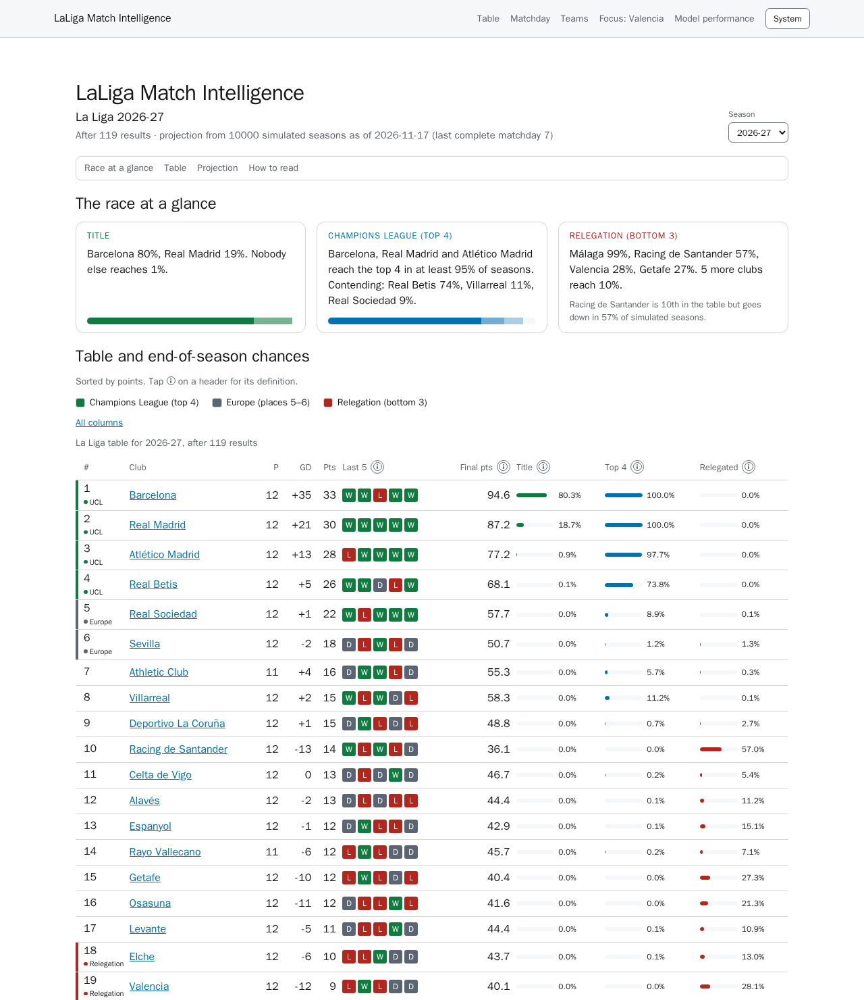
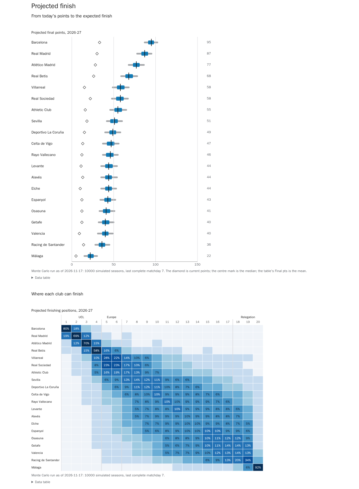
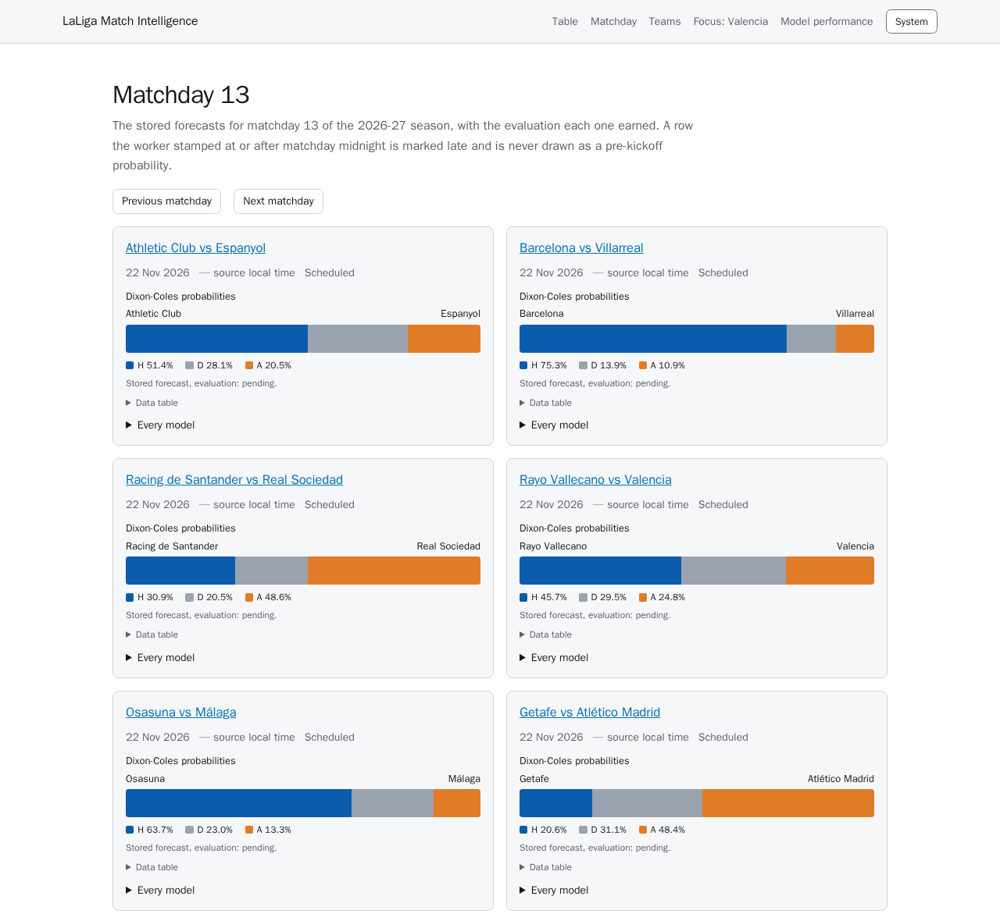
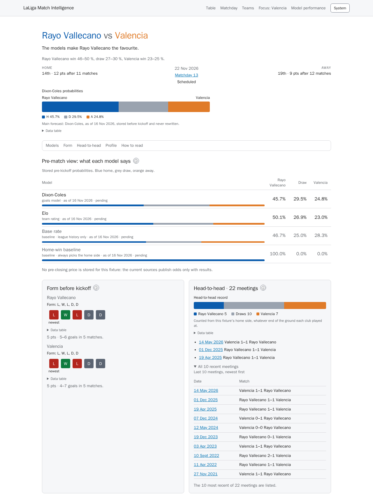
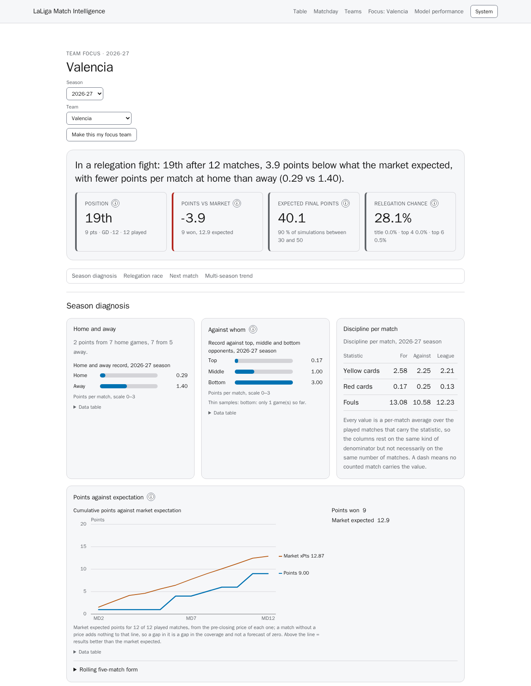
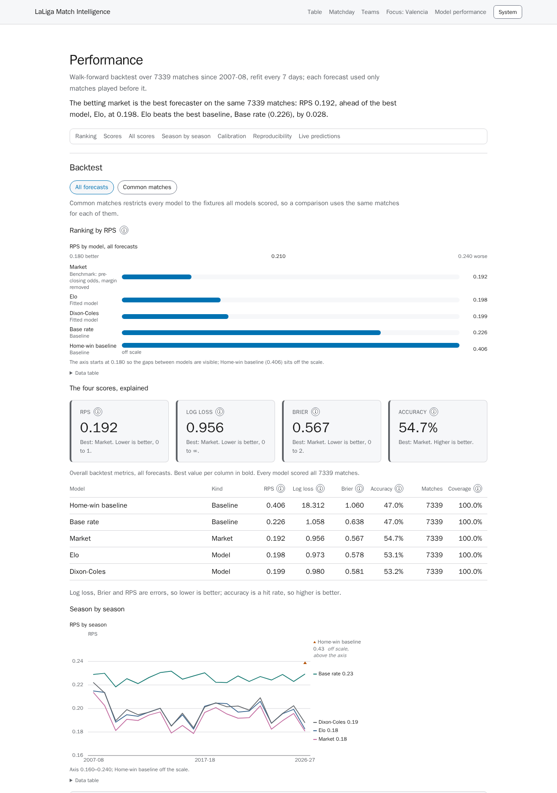
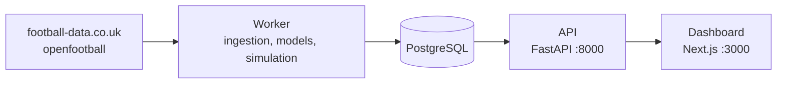

# LaLiga Match Intelligence

A local app that predicts Spanish La Liga matches, simulates the rest of the season, and measures its own accuracy against real results and the betting market. A team focus mode gives a deep view of one club (default: Valencia CF).

Everything runs on your machine with Docker. There is no hosted version: the screenshots below show what you get once the stack is running with real data.

## What it does

- **Predicts every match.** Two fitted models, Elo and Dixon-Coles, give home, draw and away probabilities for each upcoming fixture. Two baselines and the market price from bookmaker odds sit beside them for comparison.
- **Simulates the season.** A Monte Carlo simulation plays out the remaining fixtures 10,000 times and shows each club's chances of the title, the Champions League, Europe and relegation.
- **Measures itself honestly.** A walk-forward backtest over every season since 2007-08 scores each model only on matches it had not seen. Live predictions are stored before kickoff, never edited, and scored when the result arrives.
- **Explains one club in depth.** The focus page diagnoses a team's season, its relegation race, its next match and its trend since 2005-06.

## Screenshots

### League table and end-of-season chances

The current table with the race at a glance and each club's chances from the simulation.



### Season projection

Projected final points with their range, and the probability of every finishing position.



### Matchday predictions

The next matchday's fixtures, each with its stored probabilities.



### Match preview

One fixture: what each model says, both clubs' form and the head-to-head record.



### Team focus

One club's season in a sentence, its headline numbers, its home and away split and its points against market expectation.



### Model performance

How each model scores in the backtest against the baselines and the market, season by season, and how well calibrated its probabilities are.



## Requirements

- [Docker](https://docs.docker.com/get-docker/) with Compose
- `make`
- `git`
- An internet connection for the data download step

## Install and run

1. Download the project:

   ```sh
   git clone https://github.com/mgilardenghi/laliga-match-intelligence.git
   cd laliga-match-intelligence
   ```

2. Create the environment file:

   ```sh
   cp .env.example .env
   ```

   Edit `.env` and replace the placeholder `POSTGRES_PASSWORD` with a password of your choice. The stack does not start without one.

3. Build and start the app:

   ```sh
   make up
   ```

   This builds the images, prepares the database and waits until every service is healthy.

4. Open <http://localhost:3000>. The footer shows `API status: online` when the dashboard can reach the API. The API documentation is at <http://localhost:8000/docs>.

The app starts empty. Load the data next.

## Load the data

Run these commands in order. The first one downloads the match data, so it needs an internet connection; the others work offline.

```sh
make ingest-backfill
make backtest
make predict
make simulate
```

| Command | What it does |
| --- | --- |
| `make ingest-backfill` | Downloads every La Liga season from 2005-06 to the current one: results, statistics, odds and fixtures. |
| `make backtest` | Scores every model on past seasons and stores the results for the performance page. |
| `make predict` | Stores the predictions for the fixtures of the next 14 days. |
| `make simulate` | Simulates the rest of the season and stores the projected table. |

To refresh the data later, run `make ingest` (current season only), then `make predict` and `make simulate`. A page with missing data names the command that fills it.

To refresh automatically every day at 06:00 (Madrid time), start the optional scheduler with `make scheduler`. It downloads data, so it is off by default.

## Use the app

| Page | What you see |
| --- | --- |
| **Table** (`/`) | The current table, each club's end-of-season chances and the projected finish. Pick another season from the menu. |
| **Matchday** (`/matchday`) | The fixtures of a matchday with each model's probabilities. Move between matchdays with the buttons. |
| **Match** (`/matches/<id>`) | Open any fixture for its full preview, and its result once played. |
| **Teams** (`/teams`) | Every club of a season. Pick one for its season page, or make it your focus team. |
| **Focus** (`/focus`) | The deep view of your focus team: season diagnosis, relegation race, next match and multi-season trend. |
| **Model performance** (`/performance`) | The backtest report and the live predictions scored against the market. |

Every chart has a data table under it, and the `ⓘ` controls explain each metric. The theme button in the header switches between light, dark and system.

## Stop or remove

| Command | What it does |
| --- | --- |
| `make down` | Stops the app and keeps the data. `make up` starts it again. |
| `make clean` | Stops the app and deletes its database. |
| `make logs` | Follows the logs of every service. |
| `make help` | Lists every command. |

## How it works



The worker downloads the source files, fits the models and runs the simulation, and stores everything in PostgreSQL. The API serves those results, and the dashboard reads only the API. Redis carries the job queue between them.

More detail:

- [How the models work](docs/models.md): every model, the backtest and its metrics.
- [Dashboard reference](docs/dashboard.md): pages, settings and browser tests.
- [API reference](docs/api.md): every endpoint.

## Development

Development needs [uv](https://docs.astral.sh/uv/) and [pnpm](https://pnpm.io/) on the host. `make setup` installs both toolchains' dependencies, `make lint` runs the linters and type checks, and `make test` runs the unit tests. `make help` lists the rest.

## Data sources

- Match results, statistics and odds: [football-data.co.uk](https://www.football-data.co.uk/)
- Fixtures: [openfootball/football.json](https://github.com/openfootball/football.json) (CC0)

The data is downloaded when you run the app and is not included in this repository.

## License

The code is released under the [MIT License](LICENSE). The match data is downloaded at runtime from the sources above, under their own terms.

This project is not affiliated with LaLiga or any football club.
