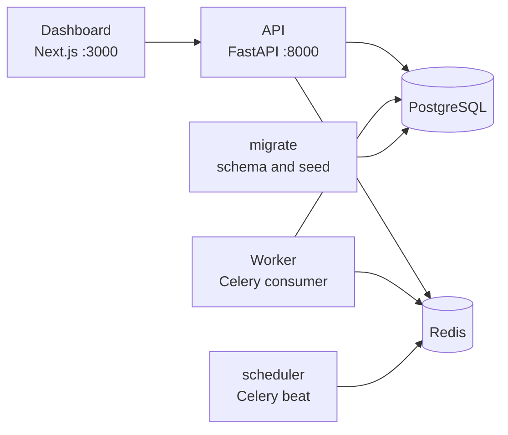
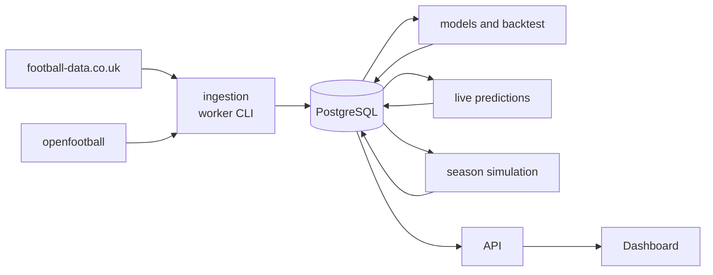

# LaLiga Match Intelligence

A local system that predicts Spanish La Liga matches, simulates the rest of the season, and measures its own accuracy against real results and the betting market. A team focus mode gives a deep view of one club (default: Valencia CF).

## Status

Milestones M0 to M6 are done.

| Milestone | Work |
| --- | --- |
| M0 | Monorepo skeleton, Docker Compose stack, CI, tooling and version pins. |
| M1 | Ingestion of football-data.co.uk and openfootball, team-name normalization, database schema and migrations. |
| M2 | The `/v1` API for teams, matches and standings. |
| M3 | Five models, the walk-forward backtest, its metrics and the model performance data. |
| M4 | Immutable live predictions and the asynchronous season simulation, on a Celery queue. |
| M5 | The server-rendered dashboard, including the team page and focus mode, with a Playwright harness. |
| M6 | This change: documentation, diagrams and polish. |

Scope and acceptance criteria live in the [MVP specification](docs/spec/mvp.md). Decisions are recorded in the [architecture decision records](docs/adr/). [How the models work](docs/models.md) explains how every model predicts and how the walk-forward evaluation scores it.

## Architecture

The stack is seven Compose services: PostgreSQL, Redis, the one-shot migration and seed job, the API, the worker, the optional scheduler and the dashboard.

| Service | What it is |
| --- | --- |
| `db` | PostgreSQL 18.7, no published port. |
| `redis` | Cache and job broker, no published port. |
| `migrate` | One-shot schema and seed job; `api` and `worker` wait for it to exit 0. |
| `api` | FastAPI, published on `127.0.0.1:8000`. |
| `worker` | Celery consumer of the `lmi` queue, `restart: unless-stopped`. |
| `scheduler` | Celery beat, in the Compose profile `scheduler`, off by default because its daily cycle downloads data. |
| `web` | Next.js, published on `127.0.0.1:3000`. |





The ingestion commands are the only ones that download the source files, and they write PostgreSQL. The backtest, the live predictions and the simulation read PostgreSQL and write their results back to it. The API serves those results. The API and the worker are the only services that query the database: the one-shot `migrate` job applies the schema and the seed, the scheduler publishes its tasks through Redis, and the dashboard reads only the API (ADR-0001).

## Quickstart

Prerequisites: Docker with Compose, and `make`. The stack itself needs nothing else. Two more tools are needed for the host-side commands and for `make setup`: [uv](https://docs.astral.sh/uv/) and [pnpm](https://pnpm.io/).

1. Create the environment file and install the Python and Node dependencies:

   ```sh
   make setup
   ```

   This copies `.env.example` to `.env` when `.env` is missing, then installs both toolchains. If you only want to run the Docker stack, `cp .env.example .env` is enough and uv and pnpm are not required.

2. Edit `.env` and replace the placeholder `POSTGRES_PASSWORD`. The Compose stack refuses to start without a value. Any character is accepted except a newline: the services build the connection URL in code instead of interpolating it into a string.

3. Build and start the stack:

   ```sh
   make up
   ```

   The command builds the images, applies the schema and the seed with the one-shot `migrate` service, waits until db, redis, api and web are healthy, then starts the worker, which now stays running because it consumes the job queue.

4. Open <http://localhost:3000> for the dashboard and <http://localhost:8000/docs> for the OpenAPI documentation. The dashboard shows `API status: online` when it can reach the API.

The worker is a long-running Celery consumer of the `lmi` queue: it stays up between jobs and only runs jobs that read PostgreSQL, so the default stack never contacts a data source and works offline. The `migrate` service is the one-shot job of the stack: it applies the migrations and the reference-data seed, and `api` and `worker` wait for it to exit 0. Ingestion downloads the source files, so it stays an explicit command: `make ingest` ingests the current season and `make ingest-backfill` ingests every season from 2005-06 on. The model and the simulator run in one-off containers from the worker image: `make predict` stores the live predictions of the next 14 days as of the Madrid date, and `make simulate` runs the season simulator once and stores and prints the projected table.

Celery beat is the clock of a daily cycle at 06:00 Europe/Madrid: it ingests the season in progress, stores that day's live predictions and simulates the league. Its ingestion step needs the network, which is why beat is opt-in: the `scheduler` Compose profile is off by default, and `make scheduler` starts it. That is what keeps `make up` offline.

`make clean` stops the stack and deletes the containers and the database volume of the `lmi` Compose project.

## Load real data

From an empty stack, in this order:

```sh
make up
make ingest-backfill
make backtest
make predict
make simulate
```

- `make up` builds the stack, applies the schema and the seed, and starts db, redis, api, web and the worker.
- `make ingest-backfill` downloads every season from 2005-06 through the current one and writes the seasons, matches, results, statistics and odds. It needs the network. `make ingest` is the same command for the current season only.
- `make backtest` fits every model on the history strictly before each weekly cutoff and stores the metrics of the scored seasons (2007 onward by default). It refuses to run when the scored range holds fewer than 380 played matches, so it needs the backfill, not a single season.
- `make predict` stores the live predictions of the next 14 days for all five models. It needs ingested scheduled fixtures and played history.
- `make simulate` runs the Monte Carlo season simulation from the Dixon-Coles fit and stores the projected table. It needs ingested matches.

What each page needs:

| Page | Needs |
| --- | --- |
| `/` | ingested results for the season, and `make simulate` for the projected columns |
| `/matchday` | ingested scheduled fixtures, and `make predict` for the probabilities |
| `/matches/[matchId]` | ingested match, statistics and head-to-head, and `make predict` for the probabilities |
| `/teams`, `/teams/[teamId]` | ingested results, statistics and upcoming fixtures |
| `/focus`, `/focus/[teamId]` | the same data as `/teams/[teamId]`, plus `make simulate` for the relegation race |
| `/performance` | `make backtest` for the backtest section, and `make ingest` plus `make predict` for the live section |
| `/dev/charts` | nothing; it draws fixed sample data |

The empty states of the pages name these commands themselves (`make ingest`, `make predict`, `make simulate`).

## Dashboard

- `/` - the current table of a season (`?season=`), with the position heatmap and the projected columns and points intervals when a simulation is stored.
- `/matchday` - the next matchday's fixtures (`?matchday=`) with the stored model probabilities per fixture.
- `/matches/[matchId]` - one match: the pre-match probabilities next to the market-implied ones, both clubs' form, the head-to-head record, the match statistics and both clubs' season profiles.
- `/teams` - the clubs of a season (`?season=`), with the control that stores the focus team.
- `/teams/[teamId]` - one club's season (`?season=`): season at a glance, home and away split, for and against, results and next fixtures.
- `/focus` - resolves the focus team and redirects to `/focus/<teamId>`; it renders nothing itself.
- `/focus/[teamId]` - the team focus page: season diagnosis, the multi-season trend, the relegation race and the next-match preview (MVP specification, section 6).
- `/performance` - the backtest metrics per model and season and the live predictions against the market (`?subset=all|common`).
- `/dev/charts` - the chart gallery, exposed only when `LMI_DEV_PAGES=1`.

[docs/dashboard.md](docs/dashboard.md) covers the read path, the shell, the routes and the browser tests in more detail.

## Commands

| Target | Description |
| --- | --- |
| `make help` | Show this help |
| `make setup` | Create .env if missing and install Python and Node dependencies |
| `make up` | Build and start the local Docker Compose stack, then wait for health |
| `make down` | Stop the stack and keep its volumes |
| `make logs` | Follow the logs of every service |
| `make ps` | Show the state of every service |
| `make ingest` | Run the football-data and openfootball ingestion for the current season (network) |
| `make ingest-backfill` | Run the ingestion for every season from 2005-06 through the current one |
| `make backtest` | Run the walk-forward backtest and store its results |
| `make predict` | Run the live predictions for the current season and store them |
| `make simulate` | Run a Monte Carlo season simulation and store its results |
| `make scheduler` | Start the Celery beat scheduler (profile "scheduler"; its daily cycle downloads data) |
| `make e2e` | Build the throwaway browser-test stack and run the tests that need no data |
| `make e2e-data` | Load the throwaway browser-test stack with real data (network, idempotent) |
| `make e2e-loaded` | Run the tests that need data against a standalone dashboard server |
| `make e2e-down` | Stop the throwaway browser-test stack and delete its volumes |
| `make lint` | Run Python and web linters, formatters and type checks |
| `make test` | Run the Python unit test suite (no database needed) |
| `make test-integration` | Run the integration tests against a throwaway PostgreSQL container |
| `make build` | Build the web application and every Docker image |
| `make api-client` | Regenerate the typed API client from the OpenAPI contract |
| `make api-client-check` | Fail when the committed API client no longer matches the API |
| `make clean` | Stop the stack and delete its volumes (project lmi only) |

## Repository layout

```
apps/web/              Next.js dashboard, talks only to the API
apps/api/              FastAPI service, the only entry point to the data
apps/worker/           Python ingestion, model fitting, live predictions and simulation jobs
packages/core/         Shared Python domain package: data, models, evaluation, live, simulation
e2e/                   Playwright browser tests for the dashboard
packages/api-client/   Typed API client generated from the committed OpenAPI snapshot
docs/adr/              Architecture decision records
docs/spec/             Specifications
docs/research/         Source research notes
docs/api.md            API reference
docs/dashboard.md      Dashboard reference
docs/models.md         How the models work and how they are evaluated
docs/roadmap.md        Phases after the MVP and early decisions
docker-compose.yml     Local stack: db, redis, migrate, api, worker, scheduler, web
Makefile               Developer entry points
.github/workflows/     GitHub Actions CI
```

## CI

GitHub Actions runs on every pull request and every push to `main`, in five jobs from `.github/workflows/ci.yml`:

- `Python lint, types, tests` - `uv lock --check`, `uv sync --all-packages --locked`, `ruff check`, `ruff format --check`, `mypy apps/api apps/worker packages`, the unit tests, then the integration tests against a PostgreSQL service container.
- `Dashboard lint, types, build` - `pnpm install --frozen-lockfile`, `pnpm --filter web lint`, `pnpm --filter web typecheck`, `pnpm --filter web build`.
- `API client drift` - runs `make api-client-check` and fails when the committed client no longer matches the API.
- `Dashboard browser smoke (empty stack)` - installs Chromium and runs `make e2e`, the `empty` tier only; it never downloads data.
- `Compose stack` - starts the stack with `make up`, checks that the worker is running and has not restarted, that `/health` answers and that the dashboard reports the API as online.

## Data sources

- Match results, statistics and odds: [football-data.co.uk](https://www.football-data.co.uk/)
- Fixtures: [openfootball/football.json](https://github.com/openfootball/football.json) (CC0)

Raw data is downloaded at runtime and is not included in this repository.

## License

The code is released under the [MIT License](LICENSE). The match data is not part of the repository: it is downloaded at runtime from the sources listed above, under their own terms.

This project is not affiliated with LaLiga or any football club.
